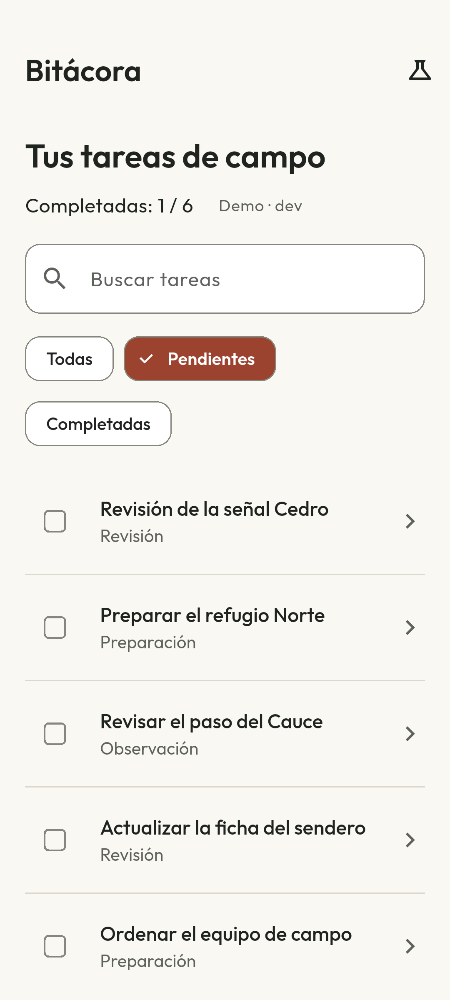
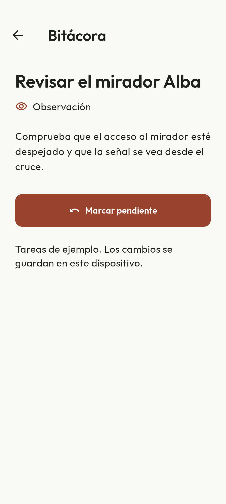

# Bitácora

[English](README.md) · [Compilación y pruebas](https://github.com/navalcode/bitacora-flutter/actions/workflows/checks.yml)

Aplicación Flutter con seis tareas ficticias de campo. Permite buscar y filtrar la lista, leer las instrucciones de cada tarea y marcarla como completada. Ese estado se guarda en el dispositivo y se recupera al reiniciar.

El proyecto muestra gestión asíncrona del estado, sustitución de peticiones, escrituras confirmadas y recuperación ante fallos de almacenamiento. La lista viene incluida en la app. No necesita cuenta, clave de API, ubicación ni backend.

<p>


</p>

## Qué puedes probar

1. Abre una tarea, lee sus instrucciones y pulsa **Marcar completada**.
2. Vuelve a la lista y compara Todas, Pendientes y Completadas. Busca por título, con o sin acentos en las vocales.
3. Abre **Escenarios de carga** con el icono de laboratorio. Selecciona Fallo simulado o Respuesta lenta. Las tareas incluidas siguen disponibles.
4. Selecciona **Carga normal** para recuperar la actualización.
5. Reinicia la app para comprobar que la tarea sigue completada.

Si no se puede leer el estado guardado, los controles quedan deshabilitados y no se muestra un contador que dé por pendientes todas las tareas. Si no se puede confirmar una escritura, la pantalla conserva el último estado confirmado. **Recargar tareas** vuelve a leer lo guardado antes de repetir una acción. Las pruebas de controlador y widgets provocan estos fallos de forma controlada, sin dañar almacenamiento real.

## Ejecutar

Entorno comprobado: **Flutter 3.38.7 / Dart 3.10.7**, **JDK 17** y **Android SDK 36**. Android requiere API 24 o superior. `pubspec.lock` fija versiones y hashes de dependencias.

```sh
flutter pub get --enforce-lockfile
flutter analyze
flutter test
flutter run --flavor dev
flutter build apk --debug --flavor dev
flutter build apk --release --flavor prod
flutter build web --dart-define=APP_ENV=dev --no-web-resources-cdn --pwa-strategy=none
```

Los flavors `dev` y `prod` son demos. En Android tienen IDs y nombres de lanzador distintos, por lo que su almacenamiento es independiente. Ambos usan `lib/main.dart`. En web, `APP_ENV` selecciona la etiqueta del entorno, sin conectar un servicio real. Un nombre desconocido falla de forma explícita. Para generar un AAB: `flutter build appbundle --release --flavor prod`.

Flutter puede elegir el JDK de Android Studio antes que `JAVA_HOME`. Configura JDK 17 para este proyecto con propiedades locales de Gradle o `GRADLE_OPTS=-Dorg.gradle.java.home=/ruta/a/jdk-17`. No incluyas rutas locales ni claves de firma en Git. No hay firma de producción configurada.

## Prueba nativa y capturas

Sustituye `DEVICE_ID` por el serial del dispositivo:

```sh
flutter test integration_test/app_test.dart --flavor dev -d DEVICE_ID
flutter drive --driver test_driver/capture.dart --target integration_test/app_test.dart --dart-define=CAPTURE_SCREENSHOTS=true --flavor dev -d DEVICE_ID --keep-app-running
```

El recorrido reinicia solo los IDs completados de esta demo, crea un controlador nuevo y deja una tarea ficticia completada. El driver opcional guarda los dos PNG en `docs/images/`. Ejecuta los comandos Flutter de build, test y drive en secuencia dentro de un mismo checkout: comparten archivos Android generados. Para comprobar el reinicio del proceso normal después de una build de integración, recompila o reinstala la entrada normal sin borrar preferencias; consulta [verificación](docs/VERIFICATION.md), en inglés.

## Leer el código

- [tasks.dart](lib/domain/tasks.dart): modelos, contratos de fuente/almacenamiento, generaciones de peticiones, límite de espera y estado confirmado.
- [completion_preferences.dart](lib/data/completion_preferences.dart): adaptador `SharedPreferencesAsync`; solo guarda IDs de tareas completadas.
- [main.dart](lib/main.dart): construcción de dependencias, navegación lista/detalle, ciclo de vida del controlador y recuperación.
- [copy.dart](lib/l10n/copy.dart): recursos ES/EN e inglés de respaldo para idiomas no soportados.
- [controller_test.dart](test/controller_test.dart): fallos, respuestas tardías, liberación del controlador, timeout y estado de solo lectura.
- [widget_test.dart](test/widget_test.dart): navegación, filtros, recuperación de almacenamiento, redimensionado y texto ampliado.
- [app_test.dart](integration_test/app_test.dart): preferencias Android reales y capturas opcionales.

[Arquitectura](docs/ARCHITECTURE.md), en inglés, explica la diferencia entre descartar un Future obsoleto y cancelar transporte, y por qué hay que leer el almacenamiento antes de editar. [DESIGN.md](DESIGN.md) recoge el diseño, las acciones independientes de cada fila y Outfit empaquetada localmente.

## Comprobaciones y límites

Hay **26 pruebas de controlador/widgets**: 17 del controlador y nueve de widgets, incluidas lectura/escritura fallidas y recuperación ES/EN a 360 × 800 con texto 1,8. [Verificación](docs/VERIFICATION.md) separa ejecuciones locales, persistencia nativa, navegador, auditoría de artefactos e intentos fallidos. El [workflow](https://github.com/navalcode/bitacora-flutter/actions/workflows/checks.yml) comprueba Android/web y tiene un job de integración en API 35.

La exportación incluye Android y web. No se han validado iOS nativo ni dispositivos físicos. Release activa R8 y reducción de recursos, sin firma de producción ni publicación en tiendas. Las auditorías de artefactos son consultivas. Las pruebas de widgets/emulador no son una certificación formal de accesibilidad.

## Licencia

Código, textos, datos e ilustraciones vectoriales originales: [MIT](LICENSE), Manuel Naval, 2026. Plantillas Flutter, fuentes y dependencias mantienen sus licencias en [avisos de terceros](THIRD_PARTY.md).
