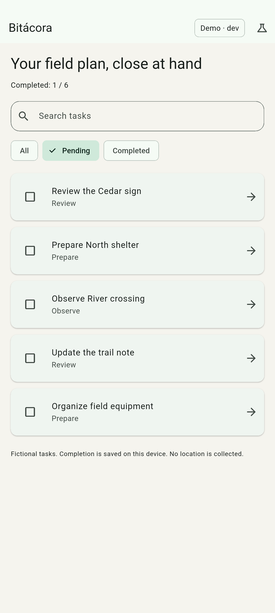
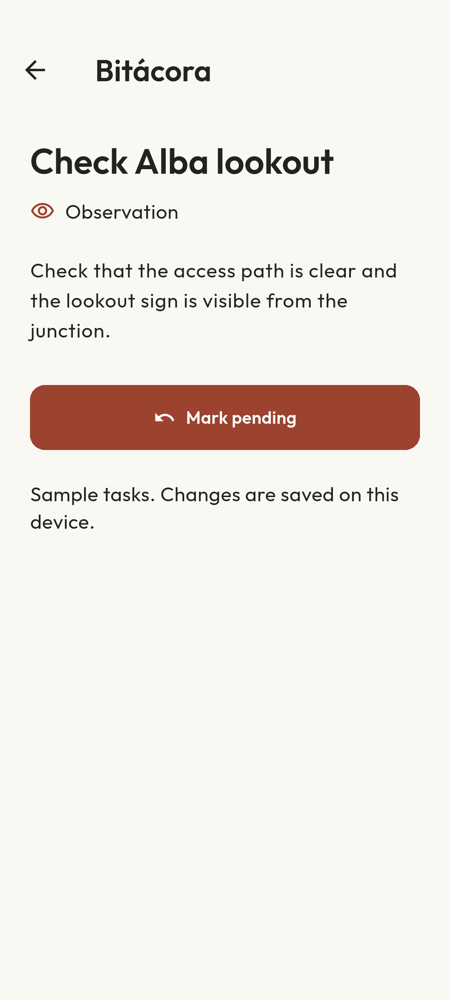

# Bitácora

[Español](README.es.md)

An original Flutter field-task demo for inspecting async state, failure recovery and local persistence. Six fictional tasks support search, pending/completed filters, details and completion saved on the device.

Both `dev` and `prod` are demo flavors. No account, API key, location or backend is required. Task copy, data and the book icon are original; interface icons retain their framework licenses.

| Pending board after saving one task | Saved task detail |
|---|---|
|  |  |

These are actual API 37 emulator captures generated by the integration journey.

## Try it

1. Open a task and mark it complete.
2. Return to the board and compare All, Pending and Completed.
3. Search Spanish titles with or without vowel accents.
4. Open the science menu and select Simulated failure or Slow response.
5. The bundled list remains available. Return to Available data to recover.
6. Restart the app: acknowledged completion remains stored locally.

The source scenarios affect only this demo. The catalog ships with the app; it is not a cached response from a production service.

## Run and verify

Validated with **Flutter 3.38.7**, Dart 3.10.7, JDK 17 and Android SDK 36. Android requires API 24+. Dependencies and their hashes are recorded in `pubspec.lock`.

```sh
flutter pub get --enforce-lockfile
flutter analyze
flutter test
flutter run --flavor dev
flutter build apk --debug --flavor prod
flutter build appbundle --release --flavor prod
flutter build web --dart-define=APP_ENV=dev --no-web-resources-cdn --pwa-strategy=none
```

Both Android flavors use `lib/main.dart`; the build flavor selects an explicit environment. Unsupported environment names fail instead of silently selecting another one. For web, `APP_ENV=dev` or `prod` selects the label; these names do not select live services.

Flutter may select an Android Studio JDK before `JAVA_HOME`. If your shared installation selects an incompatible JDK, choose JDK 17 for this project through local Gradle configuration or `GRADLE_OPTS=-Dorg.gradle.java.home=/path/to/jdk-17`. Keep machine-specific paths outside version control. No production signing key is included or configured.

Connected test and screenshot commands (replace the device ID):

```sh
flutter test integration_test/app_test.dart --flavor dev -d emulator-5554
flutter drive --driver test_driver/capture.dart --target integration_test/app_test.dart --flavor dev -d emulator-5554 --keep-app-running
```

The integration journey resets this demo's completion IDs and leaves one fictional task completed. The capture driver writes the two reviewed PNGs in `docs/images/`.

## Read the implementation

- [`tasks.dart`](lib/domain/tasks.dart): models, source/store ports, request generations, deadline and acknowledged storage state.
- [`completion_preferences.dart`](lib/data/completion_preferences.dart): actual preferences adapter.
- [`main.dart`](lib/main.dart): explicit dependency graph, list/detail navigation and UI ownership.
- [`copy.dart`](lib/l10n/copy.dart): English/Spanish resources and fallback.
- [`controller_test.dart`](test/controller_test.dart): failure, recovery, stale results, disposal, timeout and immutable exposed state.
- [`app_test.dart`](integration_test/app_test.dart): native persistence and captured UI.

[Architecture and decisions](docs/ARCHITECTURE.md) explain why ignoring a stale Future differs from cancelling a transport, and why failed storage reads block edits.

## Verified scope

Local validation on 29 October 2026: **17 controller tests, five widget tests and one native persistence journey** passed. Analyzer reported no issues. Widget checks include a 360×800 viewport and 1.8 text scaling. Android dev/prod debug APKs, a prod release AAB and web output built successfully. The normal Android entry point retained the saved completion after APK replacement and a process restart.

Manual browser review covered detail, completion, filtering, reload persistence and source failure/recovery. Release artifact analysis measured 0.95 MB DEX with aligned native libraries and no advisory-tool warnings. This is not store approval. iOS and physical devices have not been validated.

[CI passed on GitHub](https://github.com/navalcode/bitacora-flutter/actions/runs/40874563980): analyzer and 22 tests, Android dev/prod builds, optimized prod bundle, web build and the native API 35 emulator journey. Local native checks used API 37.

## License

Original application code, copy, data and vector artwork: [MIT](LICENSE), copyright 2026 Manuel Naval. Flutter/platform shells and dependencies retain their licenses; see [third-party notices](THIRD_PARTY.md).
