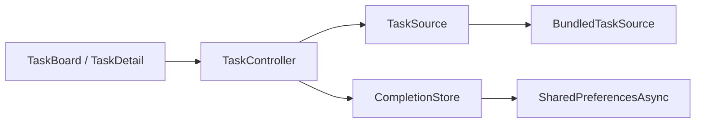

# State, lifetime and persistence

Bitácora is a small Flutter demo with original fictional tasks. It uses explicit constructor dependencies and a `ChangeNotifier` controller rather than adding a state-management framework to a six-item application.

## Requests are superseded, not transport-cancelled

Each refresh captures the scenario and a monotonically increasing generation. A result, expected failure or timeout can update presentation only if it still belongs to the latest request and the controller has not been disposed. `Future.timeout` bounds the UI wait; it does not cancel the underlying Future. The bundled source has bounded delays and no network connection.

This choice differs from coroutine cancellation in the Android example. A future real transport adapter would need to define and expose its own cancellation mechanism. Unit tests check an old success and an old failure arriving after a newer success.

## Storage failures must not look like success

The catalog ships with the app. Only completion IDs are persisted, under a versioned key. A failed read disables writes to avoid replacing unknown stored state. The completed count stays hidden until that status is available. A failed write preserves the previous in-memory completion state, but does not prove the stored values were unchanged. `canEdit` disables further writes in the controller, board and detail until a successful reload reconciles saved IDs. A catalog refresh is not a storage reload and cannot reopen editing. The read may reveal that the unacknowledged operation already succeeded, so recovery does not blindly repeat or undo it. While a write or reconciliation read is pending, the UI disables completion controls and the controller rejects overlapping writes. Repeating the same completion state avoids another write.

Two integration cases use the actual Android preferences plugin and reconstruct the controller. The second adds a test-only wrapper that throws after a native save, verifies blocked edits, reloads and preserves both completed IDs. The full suite leaves Alba and Cedar completed. A separate smoke check replaces the integration APK with the retained normal entry point and checks both completions after process restart; see [verification](VERIFICATION.md). These are emulator checks, not physical-device or hardware-fault claims.

## UI and language

The root owns the controller and disposes it. Board and detail listen to its read-only state. Details resolve a task by stable ID. Search/filter state remains in the controller during navigation; it is not restored after process death. Task completion is separate and persistent.

English and Spanish messages use typed keys. Widget tests cover read/write failures and recovery in both languages, including enlarged text. Unsupported locales fall back to English. Scrolling lists and details are checked at 360×800 with 1.8 text scaling. The environment badge is static text; task cards expose one detail action and a separate completion control. These checks do not constitute a formal accessibility certification.

Android `dev` and `prod` use different application IDs, so their local storage is separate. Both contain fictional data. The web adapter uses browser preferences scoped to its origin. No account, location, cloud synchronization or production API is involved.

## Distribution boundaries

The reviewed source export includes Android and web, with original screenshots and explicit third-party notices. The local generated iOS shell has not been validated and is excluded from the first public export. Release enables R8/resource shrinking and has no production signing configured. The advisory artifact audit does not prove store approval or physical-device behavior.
